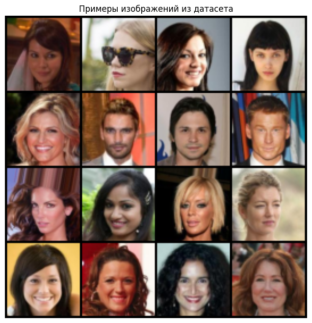
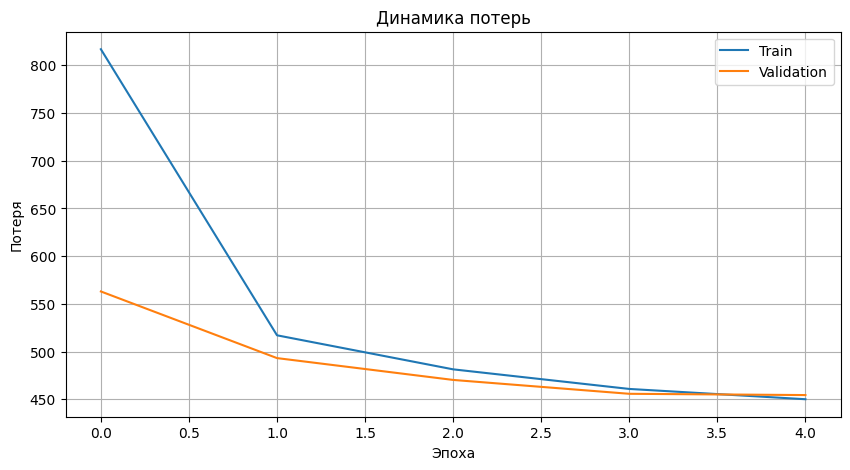
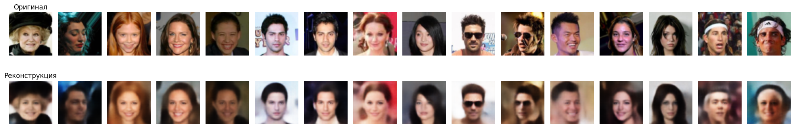
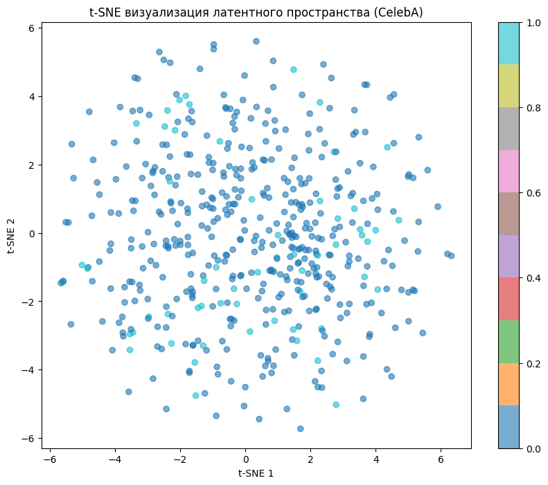
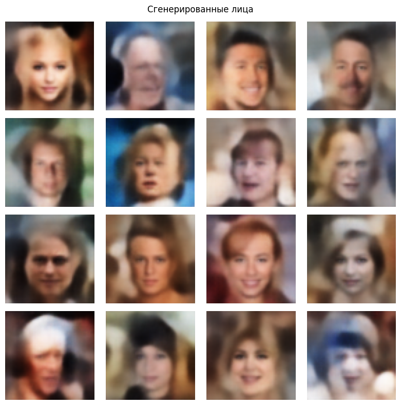
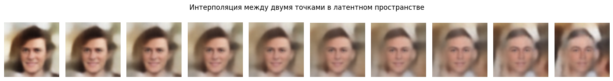
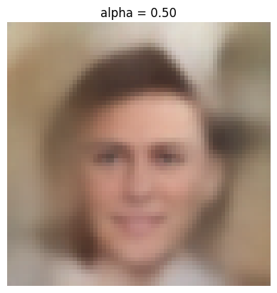

# CelebA-VAE

This repository contains a PyTorch implementation of a Variational Autoencoder (VAE) designed to generate realistic celebrity faces based on the CelebA dataset. It includes the full research pipeline—from data preprocessing and model training to evaluation (PSNR, SSIM) and latent space visualization (t-SNE)—packaged within an easy-to-follow Jupyter Notebook.

---

**Author:** Dmitry Trofimchuk  
**Date:** July 9, 2026

## 📝 Abstract
This project implements a Variational Autoencoder (VAE) for generating celebrity faces based on the CelebA dataset. The model compresses 64×64 images into a 128-dimensional latent space and reconstructs them. After training, the project demonstrates image reconstruction, generation of new faces from random noise, and smooth interpolation between latent vectors. Quality is evaluated using PSNR and SSIM metrics, and the latent space is visualized using t-SNE. This project was completed as part of a practical assignment for the "Deep Learning" course.

---

## 📚 Theoretical Background

### The Problem of Image Generation
Generating realistic synthetic images is a key challenge in computer vision. Variational Autoencoders (VAEs) can not only reconstruct input data but also generate new samples by learning the underlying data distribution. In this project, we apply a VAE to generate celebrity faces.

### Core Concepts
- **Autoencoder**: A neural network consisting of an encoder (compression) and a decoder (reconstruction).
- **VAE**: A probabilistic model where the encoder outputs the parameters of a distribution (\(\mu\), \(\log \sigma^2\)) in the latent space, and the decoder generates data from samples of this distribution.
- **Reparameterization Trick**: A technique that allows the sampling process to be differentiable, enabling training via gradient descent.

### Mathematical Formulation
The Evidence Lower Bound (ELBO) for a VAE is defined as:

$$
\mathcal{L}(\theta, \phi; x) =
\mathbb{E}_{z \sim q_\phi(z|x)} \big[ \log p_\theta(x|z) \big]
- D_{KL}\big( q_\phi(z|x) \,\|\, p(z) \big)
$$

Where:
- \(q_\phi(z|x)\) is the approximate posterior distribution in the latent space (encoder).
- \(p_\theta(x|z)\) is the data likelihood given \(z\) (decoder).
- \(p(z)\) is the prior distribution of the latent vector (typically \(\mathcal{N}(0, I)\)).
- \(\mathbb{E}_{z \sim q}\) is the expectation over samples from \(q\).
- \(D_{KL}\) is the Kullback-Leibler divergence, measuring the "distance" between two distributions.

The first term represents **reconstruction accuracy** (MSE or BCE), while the second term is the **regularization** penalty, penalizing deviations from the standard normal distribution.

---

## 📊 Dataset & Preparation

The **CelebA** (CelebFaces Attributes) dataset is used, containing over 200,000 celebrity face images. Only the images are used in this work (attributes are ignored). The dataset is automatically downloaded via `torchvision.datasets.CelebA`.

- **Preprocessing**: Images are resized to 64×64, centered, and normalized to the range [-1, 1] (for stability with the `Tanh` output activation).
- **Data Split**: The dataset is pre-split into Train (162,770), Validation (19,867), and Test (19,962) subsets.

---

## 🧠 Model Architecture

- **Encoder**: 4 convolutional layers (channels: 32→64→128→256, kernel: 4, stride: 2, padding: 1) followed by ReLU. Output shape: 256×4×4. This is followed by fully connected layers for \(\mu\) and \(\log \sigma^2\) of dimension 128.
- **Decoder**: A fully connected layer (128→256×4×4), followed by 4 transposed convolutional layers (channels: 256→128→64→32→3, kernel: 4, stride: 2, padding: 1). ReLU is used after the first three layers, with `Tanh` at the output.

### Hyperparameters
- Latent space dimension: **128**
- Batch size: **128**
- Learning rate: **1e-3** (Adam optimizer)
- Epochs: **5** (can be increased to 10 for better results)

### Loss Function
- Reconstruction loss: **MSE** (summed over pixels)
- KL-Divergence: \(-0.5 \sum(1 + \log \sigma^2 - \mu^2 - \sigma^2)\)
- **Total Loss**: `L = recon_loss + kl_loss`

---

## 🚀 Training Process

Training takes approximately 2-3 hours on a GPU for 5 epochs (using the full dataset). The model's loss is tracked over epochs for both train and validation sets to monitor convergence. 

The model checkpoint is saved as `vae_celebA.pth` after every epoch.

---

## 📈 Results & Evaluation

### Reconstruction & Quality Metrics
Original images are compared against their reconstructed counterparts.
- **PSNR** (Peak Signal-to-Noise Ratio): Higher is better.
- **SSIM** (Structural Similarity Index): Ranges [0,1], closer to 1 is better.

### Latent Space Analysis & Generation
- **t-SNE Visualization**: Latent space points are projected into 2D. Colors may correspond to specific attributes (e.g., "Smiling").
- **Generation**: New faces are generated from random vectors sampled from the prior distribution.
- **Interpolation**: Smooth transitions between two distinct faces by interpolating their latent vectors.

---

## 🛠 How to Run
1. Clone the repository: `git clone https://github.com/artrokza-lang/celeba-vae.git`
2. Open the Jupyter Notebook (`.ipynb`) in your environment (Google Colab, Jupyter Lab, or VS Code).
3. Run the cells sequentially. The notebook will automatically handle dataset downloading and model training.
